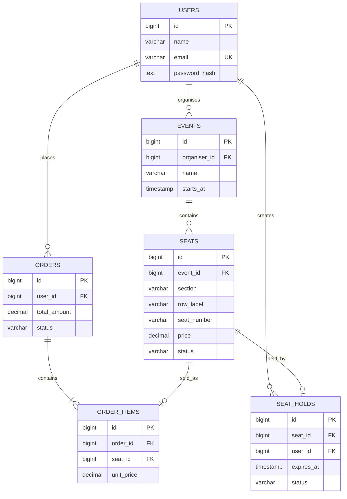
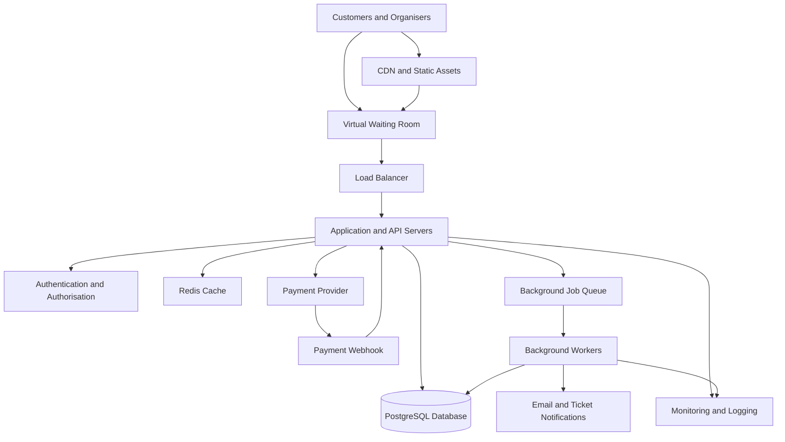

# TicketHub: Event Ticketing System Design

**Assignment:** Day 8 - Design an Event Ticketing System  
**Project:** TicketHub  
**Repository:** web-foundations-days  
**Folder:** day8/

---

# 1. Requirements

## 1.1 Project Purpose

TicketHub is an online event ticketing platform that allows customers to discover concerts and other events, view available seats, reserve seats temporarily, make payments and access their digital tickets.

The main goal is to provide a reliable, secure, fair and scalable ticket purchasing experience, even when thousands of people attempt to purchase tickets simultaneously.

### Target Users

1. **Visitors:** Browse and search for upcoming events.
2. **Customers:** Register, select seats, purchase tickets and view their orders.
3. **Event Organisers:** Create events, manage ticket availability and monitor sales.
4. **Administrators:** Manage users, events, payments and platform operations.

## 1.2 Functional Requirements

The system must allow customers to:

1. Register and log into their accounts.
2. Browse upcoming concerts and events.
3. Search and filter events by name, date, category and location.
4. View event descriptions, venues, ticket prices and seating plans.
5. View available, held and sold seats.
6. Select and temporarily reserve available seats.
7. Make payments through a secure payment provider.
8. Receive digital tickets after successful payment.
9. View their purchased tickets and order history.
10. Request cancellations or refunds where permitted.

The system must also allow organisers to create and manage events and administrators to manage the platform.

## 1.3 Non-Functional Requirements

| Requirement | Description |
|---|---|
| Performance | Event pages should load within approximately 2 seconds for most users under normal conditions. |
| Correctness | A seat must never be sold to two different customers. |
| Fairness | Customers should receive fair access to popular ticket sales through a controlled waiting queue. |
| Security | Use HTTPS, secure password hashing, authentication and role-based access control. |
| Scalability | The system should support increasing numbers of users by adding application servers. |
| Availability | Browsing and essential services should remain available during high traffic. |
| Reliability | Transactions, database constraints and backups should protect important data. |
| Accessibility | The website should target WCAG 2.1 AA accessibility standards. |
| Privacy | Customer information should be protected and only necessary information collected. |

## 1.4 Main Customer Journey

1. A customer visits TicketHub.
2. The customer browses available events.
3. The customer selects a concert.
4. The customer views the seating arrangement.
5. The customer selects available seats.
6. TicketHub temporarily holds the selected seats.
7. The customer completes payment.
8. The system confirms payment.
9. The customer receives digital tickets.
10. The customer can access the tickets from their account.

---

# 2. Traffic and Capacity Estimates

## 2.1 Given Information

The assignment provides the following information:

- Registered users: 2,000,000.
- Normal daily visitors: 50,000.
- Each visitor views 10 pages.
- Normal daily ticket sales: 5,000.
- Popular concert sale: 200,000 people.
- Available concert seats: 20,000.
- Sale duration: 10 minutes.

## 2.2 Normal-Day Traffic

### Calculate Daily Page Views

50,000 visitors × 10 pages

= 500,000 page views per day.

### Calculate Average Page Views Per Second

There are 86,400 seconds in one day.

500,000 ÷ 86,400

= 5.79 page views per second.

Therefore, TicketHub handles approximately 5.8 page views per second on an average normal day.

### Calculate Average Ticket Sales Per Second

5,000 tickets ÷ 86,400 seconds

= 0.058 ticket sales per second.

This means approximately one ticket is sold every 17.3 seconds on average.

These are daily averages. Actual traffic may be higher during busy hours.

## 2.3 Popular Concert Sale Traffic

During a popular concert sale:

- 200,000 people attempt to purchase tickets.
- Only 20,000 seats are available.
- The sale takes place within 10 minutes.

Ten minutes = 600 seconds.

### Calculate Purchase Attempts Per Second

200,000 ÷ 600

= 333.3 purchase attempts per second.

The system must handle approximately 333 purchase attempts per second during the sale.

### Calculate Required Ticket Sales Per Second

20,000 ÷ 600

= 33.3 ticket sales per second.

To sell all available seats evenly across the ten minutes, the system would need to complete approximately 33 ticket sales per second.

### Calculate Competition for Seats

200,000 ÷ 20,000

= 10.

There are approximately 10 people competing for every available seat.

## 2.4 Normal Traffic Compared With Popular Sale Traffic

| Measurement | Normal Day | Popular Sale |
|---|---|---|
| Visitors | 50,000 per day | 200,000 in 10 minutes |
| Page views | 500,000 per day | Depends on browsing and retries |
| Average page views or attempts | 5.8 per second | 333.3 purchase attempts per second |
| Ticket sales | 5,000 per day | Up to 20,000 seats |
| Main challenge | Regular traffic | Sudden traffic and competition |

The major sale's average attempt rate is approximately 57.5 times the normal daily average page-view rate.

333.3 ÷ 5.79 = 57.6.

This shows why TicketHub needs special handling for popular events.

A page view and a purchase request do not necessarily consume equal resources. Therefore, this comparison is an indicator of the traffic increase, not a complete server-capacity calculation.

## 2.5 Capacity Strategy

TicketHub will use the following techniques:

- A virtual waiting room to control the number of customers entering the purchasing process.
- Caching to reduce repeated database queries.
- A Content Delivery Network (CDN) to deliver images and static files.
- Multiple application servers to distribute incoming requests.
- Rate limiting to control excessive requests.
- Database transactions to protect ticket inventory.
- Monitoring to detect performance problems.
- Load testing before major ticket releases.

---

# 3. API Design

TicketHub will use a REST API that allows the frontend to communicate with the backend.

The API will use HTTP methods and JSON data.

## 3.1 API Endpoints

| HTTP Method | Endpoint | Purpose |
|---|---|---|
| GET | /api/events | Retrieve and browse available events. |
| GET | /api/events/{eventId} | Retrieve details of a specific event. |
| GET | /api/events/{eventId}/seats | Display available and sold seats. |
| POST | /api/seat-holds | Temporarily reserve selected seats. |
| DELETE | /api/seat-holds/{holdId} | Release a temporary seat reservation. |
| POST | /api/orders | Create an order and begin checkout. |
| POST | /api/payments/webhook | Receive payment confirmation from the payment provider. |
| GET | /api/me/tickets | Retrieve tickets belonging to the logged-in customer. |
| GET | /api/me/orders/{orderId} | Retrieve details of a customer's order. |

## 3.2 Example: Reserving Seats

A customer selects two seats and requests a temporary reservation.

### Request

POST /api/seat-holds

```json
{
  "eventId": 42,
  "seatIds": [501, 502]
}
```

### Successful Response

```json
{
  "holdId": "hold-901",
  "eventId": 42,
  "seatIds": [501, 502],
  "status": "active",
  "expiresAt": "2026-11-02T16:10:00Z"
}
```

The response confirms that the seats have been temporarily reserved.

If another customer has already reserved or purchased one of the seats, the API should return a 409 Conflict response.

## 3.3 API Security and Validation

The API must:

- Require authentication for customer purchasing operations.
- Validate all incoming information.
- Verify that customers own the holds and orders they access.
- Calculate ticket prices on the server.
- Use HTTPS to protect information in transit.
- Use idempotency keys to prevent duplicate orders during retries.
- Verify payment-provider webhook signatures.
- Return appropriate HTTP status codes.

Examples:

- 200: Successful request.
- 201: Resource created.
- 400: Invalid request.
- 401: Authentication required.
- 403: Access denied.
- 404: Resource not found.
- 409: Seat conflict.

---

# 4. Database Design

TicketHub will use PostgreSQL as its relational database.

A relational database is appropriate because ticket purchases require reliable relationships, transactions and constraints.

## 4.1 Users Table

Stores customer, organiser and administrator information.

| Column | Data Type | Constraint |
|---|---|---|
| id | BIGINT | Primary Key |
| name | VARCHAR(120) | NOT NULL |
| email | VARCHAR(255) | UNIQUE, NOT NULL |
| password_hash | TEXT | NOT NULL |
| role | VARCHAR(30) | NOT NULL |
| created_at | TIMESTAMP | NOT NULL |

## 4.2 Events Table

Stores information about concerts and other events.

| Column | Data Type | Constraint |
|---|---|---|
| id | BIGINT | Primary Key |
| organiser_id | BIGINT | Foreign Key |
| name | VARCHAR(200) | NOT NULL |
| description | TEXT | Optional |
| venue | VARCHAR(200) | NOT NULL |
| starts_at | TIMESTAMP | NOT NULL |
| status | VARCHAR(30) | NOT NULL |

The organiser_id references users.id.

## 4.3 Seats Table

Stores the seats available for each event.

| Column | Data Type | Constraint |
|---|---|---|
| id | BIGINT | Primary Key |
| event_id | BIGINT | Foreign Key |
| section | VARCHAR(80) | NOT NULL |
| row_label | VARCHAR(20) | NOT NULL |
| seat_number | VARCHAR(20) | NOT NULL |
| price | DECIMAL(10,2) | NOT NULL |
| status | VARCHAR(20) | NOT NULL |
| held_until | TIMESTAMP | Nullable |

The event_id references events.id.

The combination of event_id, section, row_label and seat_number must be unique.

The status can be:

- available
- held
- sold

## 4.4 Orders Table

Stores customer purchase information.

| Column | Data Type | Constraint |
|---|---|---|
| id | BIGINT | Primary Key |
| user_id | BIGINT | Foreign Key |
| total_amount | DECIMAL(12,2) | NOT NULL |
| status | VARCHAR(30) | NOT NULL |
| idempotency_key | VARCHAR(100) | UNIQUE |
| created_at | TIMESTAMP | NOT NULL |

The user_id references users.id.

Order statuses include pending, paid, cancelled and failed.

## 4.5 Order Items Table

Connects orders to the individual seats purchased.

| Column | Data Type | Constraint |
|---|---|---|
| id | BIGINT | Primary Key |
| order_id | BIGINT | Foreign Key |
| seat_id | BIGINT | Foreign Key |
| unit_price | DECIMAL(10,2) | NOT NULL |

The order_id references orders.id.

The seat_id references seats.id.

A UNIQUE constraint on seat_id prevents the same event-specific seat from being included in two successful orders.

## 4.6 Seat Holds Table

Stores temporary seat reservations.

| Column | Data Type | Constraint |
|---|---|---|
| id | BIGINT | Primary Key |
| seat_id | BIGINT | Foreign Key |
| user_id | BIGINT | Foreign Key |
| hold_token | VARCHAR(100) | UNIQUE |
| expires_at | TIMESTAMP | NOT NULL |
| status | VARCHAR(20) | NOT NULL |

The table records who is temporarily holding a seat and when the reservation expires.

Only one active hold may exist for a seat at a time. A production database can enforce this with a partial unique index on active holds.

## 4.7 Database Relationships

The database has the following relationships:

1. One user can organise many events.
2. One event can contain many seats.
3. One user can create many orders.
4. One order can contain many order items.
5. Each order item references one seat.
6. A seat can have only one active hold.
7. A seat can belong to at most one successful order.

## 4.8 Entity Relationship Diagram



---

# 5. Preventing Two Customers From Buying the Same Seat

One of the most important challenges in TicketHub is preventing double-booking.

Double-booking happens when two different customers successfully purchase the same seat.

For example:

- Alice selects seat A12.
- Brian also selects seat A12.
- Both customers see the seat as available.
- Both attempt to purchase it.

If the system only checks availability in the browser, both customers could proceed with the purchase.

Therefore, TicketHub must use database transactions, row locks and constraints.

## 5.1 Temporary Seat Reservation

When a customer requests a seat:

1. The server begins a database transaction.
2. It locks the requested seat row using SELECT FOR UPDATE.
3. It checks whether the seat is available or an existing hold has expired.
4. If available, it creates a temporary reservation.
5. It updates the seat status to held.
6. It commits the transaction.
7. If the seat is already held or sold, the transaction is rejected.

## 5.2 SQL Example

```sql
BEGIN;

SELECT id, status, held_until
FROM seats
WHERE id = 501
FOR UPDATE;

UPDATE seats
SET status = 'held',
    held_until = NOW() + INTERVAL '5 minutes'
WHERE id = 501
AND (
    status = 'available'
    OR (status = 'held' AND held_until < NOW())
);

-- The application checks that exactly one row was updated.
-- The corresponding hold record is created in this transaction.

COMMIT;
```

The row lock prevents another transaction from simultaneously changing the same seat.

If the update affects zero rows, the application must reject the reservation.

## 5.3 Completing the Payment

After a successful hold:

1. The customer proceeds to checkout.
2. The server verifies that the hold belongs to the customer and has not expired.
3. The server creates a pending order.
4. The payment provider processes the payment.
5. TicketHub verifies the payment confirmation.
6. A database transaction marks the order as paid.
7. The seats are marked as sold.
8. The temporary holds are converted into completed purchases.
9. Digital tickets are generated.

If payment fails, the order must not be marked as paid.

A hold can expire after five minutes, making the seat available again if it has not been successfully purchased.

The application must coordinate payment confirmation and expiry carefully. It should not keep a database transaction open while waiting for an external payment provider.

## 5.4 Additional Protection

TicketHub also uses:

- **Row-level locking:** Prevents simultaneous transactions from reserving the same seat.
- **Database transactions:** Ensures related changes succeed together or are rolled back.
- **Unique constraints:** Prevents a seat from appearing in multiple successful orders.
- **Idempotency keys:** Prevents repeated requests from creating duplicate orders.
- **Server-side validation:** Ensures the browser cannot manipulate seat prices or ownership.

The database is the final authority on seat ownership, not the customer's browser.

---

# 6. System Architecture

## 6.1 Architecture Diagram



## 6.2 Architecture Components

| Component | Responsibility |
|---|---|
| Customer Interface | Allows customers to browse events, select seats and manage tickets. |
| CDN | Delivers images, CSS, JavaScript and other static resources. |
| Virtual Waiting Room | Controls customer entry during high-demand ticket sales. |
| Load Balancer | Distributes requests across application servers. |
| Application Servers | Process API requests and apply business rules. |
| Authentication Service | Verifies customer identity and permissions. |
| Redis Cache | Stores temporary information and cached event data. |
| PostgreSQL Database | Stores users, events, seats, holds and orders. |
| Payment Provider | Processes customer payments securely. |
| Background Queue | Handles tasks that do not need immediate processing. |
| Background Workers | Generate tickets and send confirmation messages. |
| Monitoring and Logging | Tracks errors, response times and system performance. |

## 6.3 How the Architecture Handles a Major Sale

TicketHub uses several techniques to survive the sudden increase in traffic.

### 1. Virtual Waiting Room

The waiting room controls how many customers enter the purchasing process at a time.

This prevents all 200,000 customers from sending requests to the checkout service simultaneously.

### 2. Content Delivery Network

The CDN delivers images, event banners and static resources without repeatedly loading the application servers.

### 3. Horizontal Scaling

Additional application servers can be added behind the load balancer when traffic increases.

### 4. Database Protection

PostgreSQL handles seat reservations and purchases using transactions and constraints.

Connection pooling and controlled concurrency prevent excessive database connections.

### 5. Caching

Redis stores frequently accessed event information to reduce unnecessary database queries.

However, Redis is not the final authority for seat ownership.

### 6. Background Processing

Email notifications and ticket generation are handled by background workers.

This prevents slower tasks from delaying the main checkout process.

### 7. Monitoring

The system monitors response times, database health, queue length, payment failures and application errors.

This helps administrators identify problems before they affect large numbers of customers.

---

# 7. Trade-offs

## Trade-off 1: Strong Consistency vs Maximum Performance

**Decision:** Use PostgreSQL transactions, row-level locks and unique constraints.

**Advantages:**
- Prevents double-booking.
- Maintains accurate seat availability.
- Protects important purchase information.

**Disadvantages:**
- Requests for popular seats may wait for database locks.
- Heavy contention can reduce performance.

**Reason:** Correctness is more important than accepting two customers for the same seat. Caching can improve browsing performance, but seat ownership must be controlled by the database.

## Trade-off 2: Waiting Room vs Immediate Access

**Decision:** Introduce a virtual waiting room during popular ticket sales.

**Advantages:**
- Controls sudden traffic spikes.
- Improves fairness.
- Protects application servers and databases.

**Disadvantages:**
- Customers may have to wait before entering the purchasing process.
- The waiting room introduces additional infrastructure and complexity.

**Reason:** A controlled queue provides a more stable and fair purchasing experience than allowing everyone to access checkout simultaneously.

## Trade-off 3: Temporary Holds vs Immediate Purchase

**Decision:** Hold seats for a limited period, such as five minutes.

**Advantages:**
- Gives customers enough time to complete payment.
- Prevents other customers from taking selected seats during checkout.

**Disadvantages:**
- Seats may remain unavailable when customers abandon checkout.
- Expired holds must be managed carefully.

**Reason:** A short reservation period balances customer convenience with efficient ticket availability.

---

# 8. Conclusion

TicketHub requires a reliable architecture that can support everyday browsing and sudden increases in ticket purchasing activity.

The system combines a virtual waiting room, load balancing, caching, scalable application servers, PostgreSQL transactions and background processing.

The most important design decision is preventing double-booking.

This is achieved through database transactions, row-level locks, unique constraints and server-side validation.

A seat is not considered sold simply because a browser displays it as available. The purchase must be confirmed through the backend and database.

With these measures, TicketHub can provide a secure, fair and reliable ticket purchasing experience, even during highly popular concert sales.
```

---

# FILE 2: `reflection.md`

Create another file named `reflection.md` and paste the following.

<CodeBlock language="markdown" editable>
# Day 8 Reflection

The most difficult concept in this course was understanding how the frontend, API and database work together, especially when several users try to perform the same action at the same time.

At first, I thought checking whether a seat was available on the webpage was enough. I learned that the browser can display outdated information and that important decisions must be handled by the server and database. I overcame this by revisiting the lessons on APIs, database relationships and transactions, then applying them to the TicketHub seat-booking example.

For my capstone, I would improve **[insert the specific point from the feedback you received]**. I would make that improvement by **[explain what you would change, such as improving the database relationships, clarifying API responses or making the architecture diagram easier to understand]**. This would make the design clearer and more complete.

Next, I want to learn more about backend development, particularly building REST APIs, connecting them to databases and implementing authentication. I would also like to practise SQL transactions and testing API endpoints. These skills will help me move from designing systems on paper to building applications that work reliably for real users.
```

---

## Final steps in VS Code and Git

**1.** Open your repository in VS Code.

**2.** Open `day8/`.

**3.** Create the two files and paste the respective content.

**4.** Replace the two bracketed sections in your reflection with your actual lecturer's feedback.

**5.** Open the terminal in VS Code and run:

```bash
git add day8/ticketing-design.md day8/reflection.md
git commit -m "Day 8 assignment"
git push origin main
```

**6.** Verify:

```bash
git status
git log -1 --oneline
```

You should have both files committed and pushed to your existing `web-foundations-days` GitHub repository.

**Important:** The Mermaid diagrams are included as source code. GitHub can render them automatically when you view the Markdown files in your repository.